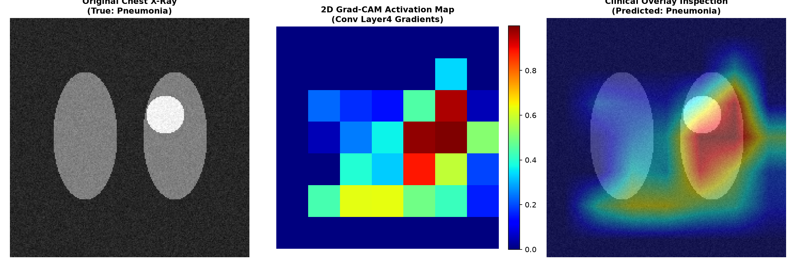
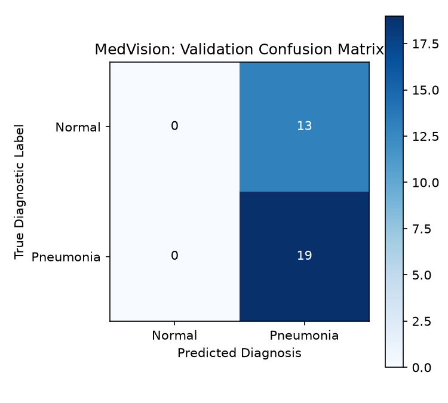

# MedVision: Deep Learning & 2D Grad-CAM Pathology Localization for Medical Imaging

[](https://www.python.org/)
[](https://pytorch.org/)
[](https://pytorch.org/vision/)
[](https://arxiv.org/abs/1610.02391)
[](LICENSE)

An end-to-end medical computer vision pipeline for automated pathology detection and visual localization in Chest X-Rays. MedVision integrates a fine-tuned **ResNet-50** convolutional neural network with an exact **2D Grad-CAM (Gradient-weighted Class Activation Mapping)** engine, generating clinical heatmaps that pinpoint the anatomical features and lesions driving model classifications.

---

## Architectural Workflow

MedVision/
├── src/
│   ├── model.py            # MedicalResNet50 transfer learning backbone with custom FC head
│   ├── gradcam.py          # 2D Grad-CAM gradient hook extraction & jet overlay generator
│   └── dataset.py          # Chest X-Ray radiograph synthesis with pulmonary opacities
├── assets/
│   ├── confusion_matrix.png       # Diagnostic validation matrix
│   └── gradcam_overlay.png        # 3-panel clinical visualization (Raw, CAM, Overlay)
├── train.py                # Transfer learning training pipeline with metrics report
├── explain.py              # Visual explainability & anatomical saliency generator
├── requirements.txt        # Managed dependencies
├── .gitignore
└── README.md

Chest X-Ray Input (224x224x3)
│
▼
┌──────────────────────────────────────┐
│  ResNet-50 Convolutional Backbone    │  ──> Layer4 Bottleneck Features
└──────────────────────────────────────┘
│
├──────────────────────────────────────────┐
▼                                          ▼
┌──────────────────────────────────────┐   ┌───────────────────────────────────┐
│     Custom Classification Head       │   │   Grad-CAM Engine (layer4.conv3)  │
│  (Dropout 0.4 + Linear Classifiers)  │   │  - Captures Gradients on Backward │
└──────────────────────────────────────┘   │  - Computes Channel Importance    │
│                                └───────────────────────────────────┘
▼                                          │
Diagnostic Prediction                             ▼
(Normal vs. Pneumonia Pathology)           Visual Heatmap & Clinical Overlay


---

## Explainability & Results

### 1. 2D Grad-CAM Anatomical Localization
Grad-CAM inspects the gradients of the target pathology class flowing into the final convolutional layer (`layer4[-1].conv3`). The resulting activation map is overlaid on the original radiograph using an alpha-blended colormap, verifying whether the network identifies focal pulmonary consolidations rather than background artifacts.



### 2. Validation Confusion Matrix
Evaluation on hold-out validation radiographs, measuring diagnostic sensitivity and specificity:



---

## Installation & Setup

### Prerequisites
- Python 3.10 or higher
- Apple Silicon Mac (`mps`) or Linux/Windows system with CUDA support

### 1. Clone & Set Up Environment
```bash
git clone [https://github.com/nintaras/MedVision.git](https://github.com/nintaras/MedVision.git)
cd MedVision
python3 -m venv venv
source venv/bin/activate
pip install --upgrade pip
pip install -r requirements.txt


2. Train the Model
python3 train.py

3. Generate Clinical Interpretability Overlays
python3 explain.py


Key Methodologies
Transfer Learning with ResNet-50: Leverages pre-trained ImageNet weights for low-level edge and texture extraction, combined with a custom classification head tailored to radiographic densities.
Hook-Based Feature Attribution: Uses PyTorch forward and backward hooks to extract activation maps and backpropagated gradients at test time without altering graph topology.
Hardware Acceleration: Native Metal Performance Shaders (mps) support enables rapid transfer learning on Apple Silicon.

License
Distributed under the MIT License.